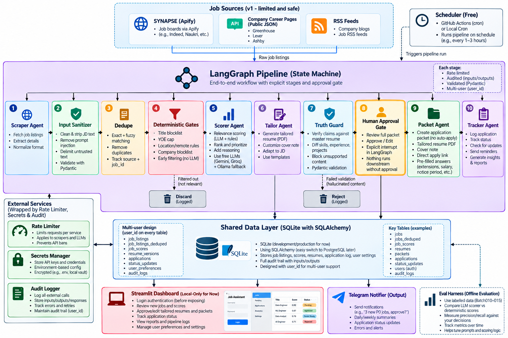

# CORTEX

Multi-agent job-search system. Human-in-the-loop by design: it prepares, **you** submit.

## Architecture


## Pipeline
`Sources → Sanitizer → Dedupe → Gates → Scorer → Tailor → Truth Guard → [HUMAN APPROVAL] → Packet → Tracker`

Rate limiter, audit log (hash-chained) and secrets wrap every external call.

## Security principles
- Job text is untrusted: sanitized, injection-flagged, delimited before any LLM sees it
- Every LLM output validated with Pydantic
- Truth Guard blocks resume claims not in the master resume
- No auto-submit, no LinkedIn automation (account safety + ToS)
- Secrets via env only; tamper-evident audit log; `user_id` on every table

## Run
```
pip install -e ".[dev]" && pytest
```
Status: v0.1 scaffold (core, gates, schema). Next: SYNAPSE importer, Apify adapter, scorer.
