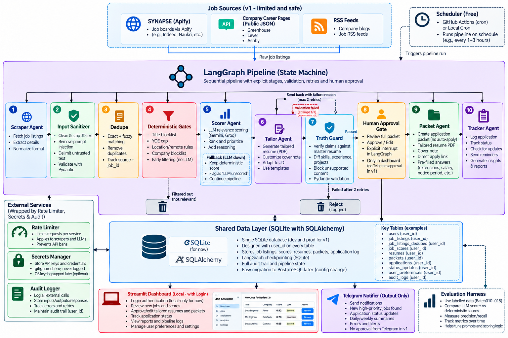

# CORTEX

Multi-agent job-search system. Human-in-the-loop by design: it prepares, **you** submit.

## Architecture


## Pipeline
`Sources → Sanitizer → Dedupe → Gates → Scorer → Tailor → Truth Guard → [HUMAN APPROVAL] → Packet → Tracker`

Rate limiter, audit log (hash-chained) and secrets wrap every external call.

## Results (real evaluation, 2026-11-02/03)
An LLM job-relevance scorer (Groq, `openai/gpt-oss-120b`) ranks jobs I actually applied to at the **62nd
percentile**, against a rule-based baseline at chance (51st), on **362 real postings** (60 applied), with ~1.9×
lift in its top bands. An ablation shows it doesn't depend on SYNAPSE's own fit label.

| | Rules | LLM (default: without `stack_fit`) |
|---|---|---|
| Mean percentile rank of applied jobs (50 = random) | 50.8 | **62.4** (60.8 with `stack_fit`) |
| Applied jobs captured in the top bands (P0/P1) | 0% | **45%**, from 24% of the queue (≈1.89× lift) |
| Pos-vs-neg AUC (15 negatives only) | 0.34 | 0.67 |

The LLM is above chance (rank z ≈ 3.3). Paired over the same 60 applied jobs it beats the rules by +11.5
percentile points (bootstrap one-sided p = 0.031; 95% CI −0.4 to +23.7, wide at this sample size). Leakage
checks: `notes` keyword check clean; the `stack_fit` ablation held. Full method, confidence intervals, threats to validity and the questions
this raises: **[docs/EVALUATION.md](docs/EVALUATION.md)**.

## Security principles
- Job text is untrusted: sanitized, injection-flagged, delimited before any LLM sees it
- Every LLM output validated with Pydantic
- Truth Guard blocks resume claims not in the master resume
- No auto-submit, no LinkedIn automation (account safety + ToS)
- Secrets via env only; tamper-evident audit log; `user_id` on every table

## For AI coding agents
Project context lives in `AGENTS.md` (single source of truth). `CLAUDE.md`, `GEMINI.md` and `.cursor/rules` just point to it.

## Run
```
pip install -e ".[dev,ui]" && pytest
cp .env.example .env
cp contact.example.yaml contact.yaml          # resume PDF header (gitignored)
cp answers.example.yaml answers.yaml          # your standard form answers (gitignored; edit them!)
# export Google Sheets -> CSV (File > Download > CSV), put files in data/import/ (gitignored)
cortex import data/import/<master>.csv data/import/<batch>.csv   # master first, then batches oldest -> newest
cortex fetch --dry-run # public Greenhouse/Lever/Ashby boards from config.yaml (sources.ats.boards); drop --dry-run to save
cortex workday-fill <job_id> --url <workday link> # types your details into an open Workday form; never clicks or submits
cortex check-open --dry-run # opt-in: are recent LinkedIn jobs still open? public no-login page, slow, stops if throttled
cortex pull --dry-run # read SYNAPSE's recent Apify datasets (LinkedIn/Naukri; APIFY_TOKEN); never starts a run
cortex score          # LLM-score new jobs (cached; dashboard + digest rank by it; rule score kept for eval)
cortex digest --dry-run # today's email digest (GMAIL_ADDRESS + GMAIL_APP_PASSWORD in .env); drop --dry-run to send
cortex daily          # pull -> fetch -> score -> digest; `cortex schedule --install` runs it daily via macOS launchd
cortex stats
cortex compare        # CORTEX deterministic score vs SYNAPSE Match
cortex eval           # recall@P0-P1, mean percentile rank; precision + AUC once there are >= 10 negatives
cortex tailor <job_id> # pick which of your 3 resumes fits (DBA / DE / AI) -> approval gate -> packet with your own PDF
cortex packet <job_id> # PDF resume + job.md for an approved job (also built automatically on approval)
cortex applied <job_id> # after you apply (also: interview / offer / rejected / no-response); history is kept
cortex report         # applications, response rate, per week, follow-ups due
cortex undo <job_id>  # revert the last status change (e.g. "applied" recorded by mistake); history keeps the correction
cortex close-stale    # preview applications with no reply for 30+ days; --yes marks them no_response
cortex llm-check      # ping Groq / Gemini / local Ollama models from config.yaml
cortex bench          # local models on the real tailor task: Truth Guard pass rate + seconds per job
streamlit run src/cortex/ui/app.py --server.address 127.0.0.1
```
Status: v0.3. Implemented: tracker import, gates, deterministic scorer, fuzzy dedupe, review UI
(with Skip decisions), audit log, LLM scorer skeleton (provider interface, Pydantic-validated output,
retry + deterministic fallback; tested with a fake provider), offline eval with cached LLM scores,
master resume schema (`master_resume.example.yaml`; real file gitignored, contact details rejected) and a
deterministic Truth Guard (skills, employers, titles, dates, projects, metrics, certs checked per employer
scope; max 2 retries to the tailor, then reject). Truth Guard does not semantically verify paraphrased prose.
Per-job LangGraph (tailor -> Truth Guard -> human approval `interrupt` -> record) checkpointed to SQLite:
a crash resumes at the gate without re-running the LLM; approval only from the Streamlit dashboard.
LLM router: per-agent fallback chains (scorer: Groq -> Gemini -> local Ollama; tailor: local Ollama only, enforced in code
because the prompt carries the resume). Live provider calls are exercised on the developer's machine; CI uses mocked HTTP.
Packet: approving in the dashboard builds `packets/.../resume.pdf`, `cover_note.pdf`, `workday.md` (every Workday field
in page order, ready to paste; answers only from your own `answers.yaml`) + `job.md` (re-checked by Truth Guard; text
escaped so LLM output can't inject PDF links). You still apply yourself.
ATS source: `cortex fetch` reads companies' public Greenhouse / Lever / Ashby job-board JSON (no login, no key),
keeps postings matching title + India-location filters, then runs the same sanitizer (injection-flagged jobs go to
manual review), gates, deterministic score and cross-source dedupe. Slugs are validated, redirects are not followed,
responses are size-capped, and a re-fetch never changes a job you acted on. A to_apply job that disappears from its
company's board is marked closed (an exact signal). LinkedIn postings are never checked automatically (no LinkedIn
scraping); the review queue hides postings older than `freshness.max_age_days` instead, view-only. Parsers are tested against fixtures built
from the vendors' documented shapes; live responses are checked with `cortex fetch --dry-run` on the developer's machine.
Daily run: `cortex daily` = fetch -> LLM-score new jobs -> email digest, scheduled with a launchd job on the Mac
(local, because the DB and resume never leave it). Each step fails independently and the failure is reported in the
digest. The digest goes only to the sender's own Gmail (no recipient setting exists), holds counts + company/title
only, strips links and control characters from job text, and never includes resume content or action links.
SMTP sending is tested with a fake server; the real Gmail send is checked on the developer's machine.
Apify source: `cortex pull` reads the datasets SYNAPSE's own scheduled Apify runs already produced (read-only API with
the owner's token; it never starts a run or touches LinkedIn). Rows merge with the same jobs imported from the sheet
(same source + job id), which only gain a missing description. The parsers were built and checked against real dataset
rows; that check found Naukri rows with no company object (now read from the company URL) and Snowflake titles that
the first title filter dropped. LinkedIn applicant counts now feed the deterministic score.
Not yet: cover note, real LLM eval numbers (pending runs on the developer machine), Apify adapter.
