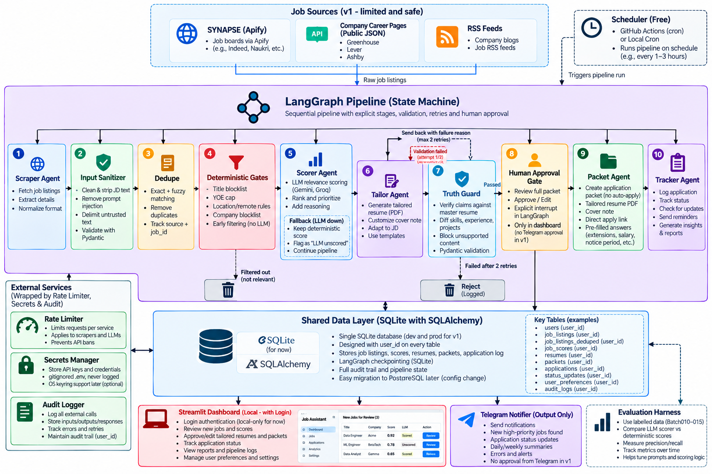

# CORTEX

Multi-agent job-search system. Human-in-the-loop by design: it prepares, **you** submit.

## Architecture


## Pipeline
`Sources → Sanitizer → Dedupe → Gates → Scorer → Tailor → Truth Guard → [HUMAN APPROVAL] → Packet → Tracker`

Rate limiter, audit log (hash-chained) and secrets wrap every external call.

## Security principles
- Job text is untrusted: sanitized, injection-flagged, delimited before any LLM sees it
- Every LLM output validated with Pydantic
- Truth Guard blocks resume claims not in the master resume
- No auto-submit, no LinkedIn automation (account safety + ToS)
- Secrets via env only; tamper-evident audit log; `user_id` on every table

## For AI coding agents
Project context lives in `AGENTS.md` (single source of truth). `CLAUDE.md`, `GEMINI.md` and `.cursor/rules` just point to it.

## Run
```
pip install -e ".[dev,ui]" && pytest
cp .env.example .env
# export Google Sheets -> CSV (File > Download > CSV), put files in data/import/ (gitignored)
cortex import data/import/<master>.csv data/import/<batch>.csv   # master first, then batches oldest -> newest
cortex stats
cortex compare        # CORTEX deterministic score vs SYNAPSE Match
streamlit run src/cortex/ui/app.py --server.address 127.0.0.1
```
Status: v0.2. Implemented: tracker import, gates, deterministic scorer, fuzzy dedupe, review UI, audit log.
Next: Apify adapter, LLM scorer + eval harness.
